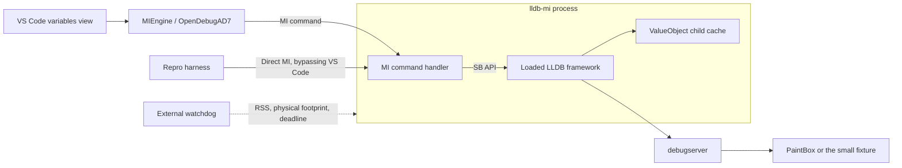
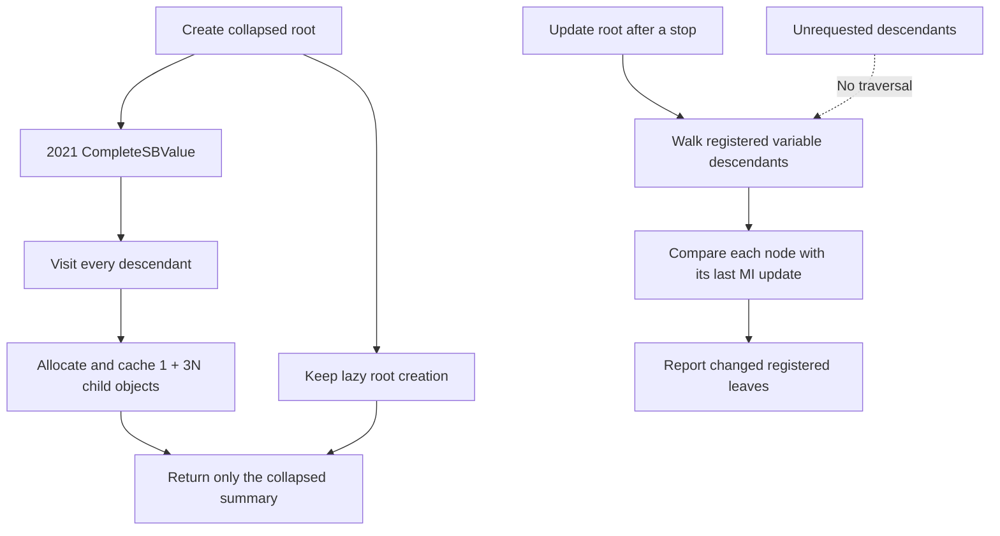
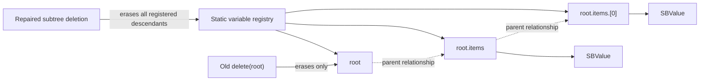

# lldb-mi memory leak reproduction and validation

The installed debugger eagerly builds LLDB child objects when the client creates
one collapsed variable. A bounded reproduction and macOS allocation histories
confirm that mechanism. Unmodified HEAD already contains upstream's removal of
that traversal, but misses updates to expanded fields and leaves child variables
accessible after parent deletion.

The working-tree repair preserves lazy creation, updates only registered
descendants, deletes complete registered subtrees, and prevents expression
results from being retained as LLDB persistent `$N` variables. The upstream
traversal-removal patch alone does not pass the correctness probe.

This repository contains the runnable reproduction, MI regression tests, an
experimental upstream backport, and the measured investigation results. The
production fix lives in the separate `lldb-mi` repository. Measurements were
taken on October 19–20, 2026, on macOS arm64.

## Implemented scope and measured result

No LLVM, LLDB framework, MIEngine, VS Code, or PaintBox source change is required
for the demonstrated defects. Shipping the fix to the normal VS Code debugger
requires separately packaging/selecting the rebuilt executable with a compatible
LLDB runtime. The original PaintBox outage has not been replayed.

The production changes are in `MICmdCmdVar.{h,cpp}` and
`MICmnLLDBDebugSessionInfoVarObj.{h,cpp}`:

- An explicit parent-to-children registry drives iterative updates and deletion.
  Ordinary value replacement preserves descendants. Deletion reports `ndeleted`,
  supports `-c`, and rejects unknown names.
- Each registered child remembers its index. Refresh requests only those
  indices, checks the member still matches, and rebinds expression children.
- Per-variable snapshots track value, availability/scope, and type since the last
  MI update. Evaluation/re-listing cannot consume notifications, repeat polling
  is empty, and a type change removes obsolete descendants.
- Duplicate names cannot overwrite another root. Re-listing preserves formats.
  Expressions suppress persistent results and retain their evaluation frame for
  recovery after an invalid result.

Five independent creation runs per build/size, without malloc logging, used the
same compiler flags and Command Line Tools LLDB framework. Times are medians:

| Build | Elements | Create time | Physical-footprint increase |
| --- | ---: | ---: | ---: |
| Rebuilt 2021 eager traversal | 8,192 | 195.45 ms | 27.41 MiB |
| Unmodified HEAD | 8,192 | 6.12 ms | 0.156 MiB |
| Working-tree repair | 8,192 | 6.20 ms | 0.266 MiB |
| Rebuilt 2021 eager traversal | 32,768 | 743.01 ms | 112.66 MiB |
| Unmodified HEAD | 32,768 | 6.46 ms | 0.172 MiB |
| Working-tree repair | 32,768 | 6.68 ms | 0.250 MiB |

The large creation improvement preserves the upstream lazy-creation change.
The additional repair fixes correctness and continued retention:

| 1,000 create/expand/delete cycles, 8,192 elements | Unmodified HEAD | Repair |
| --- | ---: | ---: |
| Deleted child still accessible | 1,000 cycles | 0 cycles |
| Ordinary variable: total footprint increase | 1.078 MiB | 0.234 MiB |
| Expression `(payload)`: total footprint increase | 72.984 MiB | 4.234 MiB |
| Expression: growth during cycles 100–1,000 | 62.281 MiB | 0 MiB observed |
| Registered objects deleted per cycle | Only root | All 4 |

Updating five registered nodes takes about 0.25 ms per unchanged poll with either
256 or 32,768 array elements. Unmodified HEAD takes about 0.02–0.03 ms but skips
descendant changes. Restoring correct work has a small absolute cost; it does not
scale with hidden array width in these runs. These are debugger-operation timings,
not inferior-program throughput measurements.

A fixed-build malloc-logging run at 8,192 elements has no `ValueObjectChild`
entry before creation, after creation, or after deletion, and no
`ValueObject::CreateChildAtIndex` allocation stack. All nine `heap`, `vmmap`, and
`malloc_history` commands completed successfully.

The [comparison summary](/Users/vrajpandya/repo/lldb-mi/build-memory-evidence/comparison-1/summary.json)
includes binary hashes, individual timings, memory checkpoints, old-build
contract failures, and raw-run directories. The measured fixed executable is
`build-memory-evidence/lldb-mi-fixed-measured`; the current build is
`build-memory-current/src/lldb-mi`.

## Run the regression suite

`contracts.cpp`, `contracts.py`, and `contracts_formatters.py` exercise real MI
sessions: descendant updates, repeated polling, assignment, output modes,
formatting, duplicate names, unrelated roots sharing a prefix, recursive and
children-only deletion, high-index pages, pointer null/recovery, expression
rebinding, scope exit, synthetic container shrink/regrowth and type changes,
and cyclic target types. Deletion counts and access failures check ownership
through the normal MI interface.

The synthetic fixtures avoid a compatibility issue discovered during validation:
the older CLT LLDB formatter interprets a vector built with the newer Xcode C++
library as empty. Simple structs and a small LLDB formatter isolate MI handling
from that library mismatch.

```sh
cmake -S . -B build-repro -G Ninja \
  -DLLDB_MI_EXECUTABLE=/path/to/lldb-mi
cmake --build build-repro
ctest --test-dir build-repro --output-on-failure

python3 benchmark.py \
  --before build-memory-evidence/lldb-mi-current-before \
  --after build-memory-current/src/lldb-mi \
  --legacy build-memory-evidence/lldb-mi-baseline \
  --output build-memory-replay/comparison --repeats 5
```

CTest requires macOS debugger permissions and `xcrun clang++`. Each run retains
evidence in a fresh temporary directory printed in the test log.
`INCLUDE_TESTS=ON` additionally enables the existing GoogleTest tests.
For AddressSanitizer/UndefinedBehaviorSanitizer builds, add
`-fsanitize=address,undefined -fno-omit-frame-pointer` to compiler flags,
`-fsanitize=address,undefined` to executable linker flags, and set
`LLDB_MI_MEMORY_TEST_MAX_MIB=1024` for instrumentation overhead. The default
watchdog remains 512 MiB for normal builds.

Validation completed: all 11 CTest tests passed in the normal build and in the
combined AddressSanitizer/UndefinedBehaviorSanitizer build, including 145 checks
inside the MI contract scenario, 100 unchanged-update polls, and 100 lifecycle
cycles. The 1,000-cycle stress runs above are separate. The system LLDB framework
is not sanitizer-instrumented. The first sanitizer attempt correctly hit the
512 MiB watchdog; the 1 GiB rerun passed without sanitizer diagnostics.
See the [validation record](/Users/vrajpandya/repo/lldb-mi/build-memory-evidence/final-validation/summary.json).

## Problem statement and scope

The [incident diagnosis](codex://threads/01a157d4-b6a5-7490-b719-7e40f906b521?hostId=remote-ssh-discovered%3Amac-mini)
recorded two lldb-mi processes at approximately 45 GiB and 40 GiB of accounted
memory, compressor exhaustion, and a forced reset. Those are historical OS
accounting observations, not measurements of resident RAM from this reproduction.
The original PaintBox MI request stream and allocation stacks were not captured.

The new experiment establishes a concrete defect in the installed binary without
VS Code, PaintBox, invalid C++ objects, or expression evaluation. It does not yet
prove which request triggered the original incident.

The expected contract is:

1. Creating a collapsed aggregate must not materialize all its descendants.
2. Updating a parent must report changes in its registered descendants, even if
   the aggregate parent has no scalar change flag.
3. Deleting a parent must remove its registered descendants and their owned
   references. Updating a parent must preserve its registered children.

MI creates child variable objects on request and defines parent deletion to
include children. See the [GDB MI variable object specification](https://sourceware.org/gdb/current/onlinedocs/gdb.html/GDB_002fMI-Variable-Objects.html).

## Verified findings

The installed cpptools notice identifies source revision
`2388bd74133bc21eac59b2e2bf97f2a30770a315`. Unmodified repository HEAD is
`1aa9e8f`. It includes `2340ff25bc46201b20779bef5bc399bf994895f0`,
the December 2024 change removing recursive child traversal.

The installed executable currently has mode `0644`. Experiments used an executable,
byte-identical copy, SHA-256
`aae1bed7237ef171236448d5ef28861aa4e46723759441b9d406177ab11b253e`.
The original file and its permissions were preserved.

### Allocation evidence

The fixture is a fully initialized array of two-integer structures. One command,
`-var-create root * payload`, returns `value="{...}"`. No child-list command is
sent in the allocation experiment.

| Experiment | Result |
| --- | --- |
| Installed binary, 8,192 elements, 64 KiB target object | 24,577 `ValueObjectChild` allocations occupying 37,750,272 bytes, about 36 MiB |
| Rebuilt 2021 source, 8,192 elements, stack logging enabled | 24,577 child objects; creation took 430 ms |
| Same source with upstream traversal removal, same framework | No `ValueObjectChild` entry in the heap snapshot; creation took 23 ms |
| Rebuilt 2021 source, 32,768 elements, logging disabled | Creation increased physical footprint by 113.08 MiB and took 730 ms |
| Same source with traversal removal, same framework | Creation increased physical footprint by 0.172 MiB and took 7.17 ms |

These are individual measurements, not a statistical performance benchmark.
The controlled before/after builds use the same Command Line Tools LLDB framework
and build flags. The installed binary loads the Xcode LLDB framework; its child
objects have a different allocation size. Compare counts across those runtimes,
and compare byte deltas and latency within the controlled pair.

`malloc_history` attributes the child allocations to this call path:

```text
CMICmdCmdVarCreate::Execute
  CMICmdCmdVarCreate::CompleteSBValue
    CMICmdCmdVarCreate::CompleteSBValue       repeated recursively
      lldb::SBValue::GetChildAtIndex
        lldb_private::ValueObject::GetChildAtIndex
          lldb_private::ValueObject::CreateChildAtIndex
            operator new
```

The count is explained by the fixture: one array child, 8,192 structure children,
and 16,384 integer children. The client requested none of them.

The baseline heap still contains the same 24,577 child objects after deleting
the root. LLDB frame/value caches can retain reachable objects; this observation
does not by itself prove an unreachable malloc leak. The allocation problem is
unnecessary materialization and retention. Separately, the variable registry
probe below demonstrates incorrect lifetime management.

### Correctness counterexamples

The update fixture stops at `first = 42`, registers the first array element and
its fields, resumes to `first = 43`, then sends `-var-update 1 root`.

| Build | Parent update result |
| --- | --- |
| Rebuilt 2021 source | Reports `root.items.[0].first`, value `43` |
| 2021 source plus upstream traversal removal | `changelist=[]` |
| Current HEAD | `changelist=[]` |

An explicit evaluation of the leaf returns `43` in all three cases. The value is
available; the change notification is missing.

The lifecycle probe registers a root, its array child and two array elements,
deletes the root, then evaluates the array child. Both the installed binary and
current HEAD return `^done,value="[4]"`. All ten tested cycles leave their child
accessible. Correct behavior is an error for the deleted child's name.

## Reference diagrams

### Where the memory accumulates



Allocations in the loaded framework count against the lldb-mi process. The
allocation stacks establish that lldb-mi's traversal requests these objects;
the process name alone would not establish that.

### Historical and repaired traversal



The repaired update path visits registered descendants even when the root's
own change flag is false. Filtering after `GetChildAtIndex` is too late to prevent
allocation.

### Ownership and deletion



The old registry independently owned every entry and retained descendants when
the parent was removed. The repair indexes these parent relationships explicitly
and removes every descendant entry, edge, and owned SBValue reference.

## Plan 1 Generate and preserve the reproduction

The deterministic aggregate, lifecycle and update probes are implemented in
`fixture.cpp` and `repro.py`. The next incident-specific step is to capture the
PaintBox debugger's MI commands and reduce the failing request sequence to the
smallest fixture.

1. Record debugger binary hash, source revision, actual loaded LLDB path/version,
   compiler, architecture, extension version and fixture contents.
2. Run the deterministic aggregate with 8,192 and 32,768 elements. Measure both
   instrumented allocations and uninstrumented physical footprint.
3. Run the two semantic counterexamples with `--expect-correct`. They must
   fail on unmodified HEAD and pass on the repair.
4. Capture a bounded PaintBox replay with engine logging. Isolate create, stack
   listing, child listing and update requests. Minimize the actual trigger while
   retaining its MI sequence and stop location.
5. If the incident requires a container before construction, preserve that stop
   condition in a separate fixture. Do not claim that a valid aggregate fixture
   reproduces uninitialized formatter behavior.

The harness logs MI requests/responses and samples both RSS and physical footprint
every 50 ms from outside the debugger. Defaults are 512 MiB and 90 seconds.
Crossing either memory threshold or the deadline terminates the owned debugger.
Recorded inferior PIDs are cleaned up with process-identity checks. The memory
threshold is a sampled stop condition, not a hard allocator limit.

A 128 MiB guard test terminated its debugger and preserved
`guard_reason=["memory limit"]`; process cleanup was checked. Stack logging is
enabled only in the debugger's environment, and target environment inheritance is
disabled. `MallocStackLoggingNoCompact` is deliberately not enabled for these
longer allocation comparisons. Apple's [malloc debugging documentation](https://developer.apple.com/library/archive/documentation/Performance/Conceptual/ManagingMemory/Articles/MallocDebug.html)
describes the logging modes.

Example runs, from the repository root, using the builds produced in this
investigation:

```sh
python3 repro.py \
  --lldb-mi build-memory-evidence/lldb-mi-baseline \
  --output build-memory-replay/baseline \
  --count 8192 --stack-logging --diagnostics

python3 repro.py \
  --lldb-mi build-memory-evidence/lldb-mi-upstream-fix \
  --output build-memory-replay/upstream \
  --count 8192 --stack-logging --diagnostics

python3 repro.py \
  --lldb-mi build-memory-current/src/lldb-mi \
  --output build-memory-replay/update \
  --mode update --count 4 --expect-correct

python3 repro.py \
  --lldb-mi build-memory-current/src/lldb-mi \
  --output build-memory-replay/lifecycle \
  --mode lifecycle --count 4 --cycles 10 --expect-correct
```

Use a fresh output directory for each run. Without `--expect-correct`, successful
execution means the observation completed, not that the debugger is correct.
With that option, an omitted update or surviving child makes the command exit 1.
Timeouts and watchdog stops also exit 1.

To rebuild the controlled pair on this Mac from local Git history, use a fresh
`build-memory-rebuild` directory:

```sh
mkdir -p build-memory-rebuild/source
git archive 2388bd74133bc21eac59b2e2bf97f2a30770a315 |
  tar -x -C build-memory-rebuild/source
python3 - <<'PY'
from pathlib import Path
p = Path("build-memory-rebuild/source/src/CMakeLists.txt")
text = p.read_text()
assert "CXX_STANDARD 14" in text
p.write_text(text.replace("CXX_STANDARD 14", "CXX_STANDARD 17"))
PY
cmake -S build-memory-rebuild/source -B build-memory-rebuild/build -G Ninja \
  -DCMAKE_POLICY_VERSION_MINIMUM=3.5 \
  -DCMAKE_BUILD_TYPE=RelWithDebInfo \
  -DCMAKE_PREFIX_PATH=/opt/homebrew/opt/llvm@16 \
  -DUSE_LLDB_FRAMEWORK=ON \
  -Dlib_lldb=/Library/Developer/CommandLineTools/Library/PrivateFrameworks/LLDB.framework/Versions/A/LLDB \
  -DCMAKE_BUILD_RPATH=/Library/Developer/CommandLineTools/Library/PrivateFrameworks
cmake --build build-memory-rebuild/build -j 4
cp build-memory-rebuild/build/src/lldb-mi build-memory-rebuild/baseline-lldb-mi
xcrun dsymutil build-memory-rebuild/baseline-lldb-mi
patch -d build-memory-rebuild/source -p1 \
  < upstream-118-backport.patch
cmake --build build-memory-rebuild/build -j 4
cp build-memory-rebuild/build/src/lldb-mi build-memory-rebuild/upstream-lldb-mi
xcrun dsymutil build-memory-rebuild/upstream-lldb-mi
```

Each diagnostic run preserves `report.json`, `mi-transcript.txt`, `memory.jsonl`,
`stderr.txt`, and before/after/deleted `heap`, `vmmap` and `malloc_history` output.
The final harness also copies its fixture into each new run directory.

## Plan 2 Explain and attribute the failure

The report should preserve three distinct findings:

| Finding | Source reference | Evidence |
| --- | --- | --- |
| Eager creation in the installed revision | `CMICmdCmdVarCreate::CompleteSBValue` in the [2021 source](https://github.com/lldb-tools/lldb-mi/blob/2388bd74133bc21eac59b2e2bf97f2a30770a315/src/MICmdCmdVar.cpp#L300) | Heap counts and recursive malloc stacks |
| Missing descendant updates in unmodified HEAD | `CMICmdCmdVarUpdate::Execute` and `ExamineSBValueForChange` in the [preserved command source](/Users/vrajpandya/repo/lldb-mi/build-memory-evidence/MICmdCmdVar.before.cpp:430) | Child changes to 43, parent reports an empty list |
| Orphaned child registrations | `VarObjDelete` in the [preserved registry source](/Users/vrajpandya/repo/lldb-mi/build-memory-evidence/MICmnLLDBDebugSessionInfoVarObj.before.cpp:358) | Child can still be evaluated after deleting its root |

The old `PrintValue` enumerates LLDB children before consulting the variable
registry. Removing recursion in `ExamineSBValueForChange` alone does not make that
path lazy. The repair removes both helpers and walks registered names instead.

Use allocation ownership and live-object counts as the primary explanation.
Allocator high-water marks, shared mapped images, and stack-logging overhead can
make process footprint misleading. An empty `leaks` report would not establish
bounded retention of reachable objects.

Exit criterion: one minimized MI sequence, an allocation stack, the retaining
owner, and a matched before/after comparison. Attributing the original outage
additionally requires matching its PaintBox request/stack signature.

## Plan 3 Implement the complete fix

The following is the design checklist from the initial investigation. The
implementation and measured outcomes are recorded above. MI integration checks
exercise ownership through deletion counts and access failures; they do not add
a test-only registry API. Full adapter/PaintBox replay remains an adoption step.

### A Preserve lazy creation

Keep the current nonrecursive `CompleteSBValue` behavior. Create the root's
metadata and summary without walking its descendants. Do not restore the older
64-child workaround: a width cap can hide legitimate values and still multiply
through nested aggregates.

The included `upstream-118-backport.patch` reproduces upstream's change against
the 2021 revision. It is an experimental comparison patch, not the complete
recommended repair, because it fails the update probe.

### B Update only the registered variable tree

Replace `CMICmdCmdVarUpdate::Execute` and `PrintValue` together.

1. Add an explicit parent-to-registered-children index, using the existing
   `GetVarParentName()` relationship. Preserve a child's index/path when
   `-var-list-children` creates it.
2. Walk the registered subtree independently of the root's scalar change flag.
   Do not enumerate all LLDB children and then discard unregistered ones.
3. Refresh only registered bindings after a stop or expression reevaluation.
   If refreshing requires child lookup, request only recorded child indices or
   paths. Detect invalid, out-of-scope, replaced or type-changed bindings.
4. Initialize each registered value before formatting and compare it with its
   last MI-update snapshot. LLDB's change flag is stop-related, so a per-variable
   snapshot prevents repeated notifications. Preserve the explicit assignment
   flag and persist its cleared state.
5. Emit each changed registered node once, with correct print-value, scope and
   type-change fields. Propagate recursive failures.

Conceptually:

```text
registered_nodes = snapshot_registered_subtree(root)
for node in registered_nodes:
    refresh_only_this_registered_binding(node)
    change = capture_change_and_scope_state_once(node)
    save_state_without_removing_descendants(node)
    append_MI_change_record_if_needed(node, change)
```

For V registered nodes, inspect V values, with map/set lookup overhead, instead of
every potential descendant in the target. A bounded child page creates objects
only for the requested page. Formatter-internal work can still depend on the
formatter; this change does not place a resource bound on arbitrary formatters.

### C Repair lifetime management without breaking updates

Change `MICmnLLDBDebugSessionInfoVarObj.{h,cpp}` and `CMICmdCmdVarDelete`.

- Separate insertion/replacement from subtree removal. **Do not simply make
  `VarObjDelete` recursive:** `VarObjAdd` currently calls it, and `VarObjUpdate`
  calls `VarObjAdd`. That would delete expanded children on ordinary updates.
- Implement subtree deletion using explicit parent relationships, with an
  iterative worklist. Do not infer ownership from string prefixes; unrelated
  caller-assigned names can share a prefix.
- Remove descendants, their adjacency entries, and their SBValue references.
  Preserve the parent for `-var-delete -c`; reject unknown names and report
  deletion results consistently with the supported MI contract.
- Clear registry state at session teardown and ensure its owner mutations remain
  serialized with command processing. Do not hold a new registry lock while
  invoking arbitrary LLDB formatter code.
- Suppress persistent results for varobj expression evaluation. The registry
  controls these values' lifetimes; adding an extra LLDB `$N` owner defeats
  deletion even when the registry is empty.

Registry cleanup does not promise that LLDB immediately returns every cached
page to the OS. Assert ownership/count invariants and bounded steady-state
growth, rather than exact RSS restoration.

### D Validation required before adoption

| Gate | Required result |
| --- | --- |
| Collapsed aggregate at multiple sizes | No descendant `ValueObjectChild` growth attributable to root creation |
| Parent update after 42 to 43 | Correct leaf appears exactly once; a subsequent unchanged update is empty |
| Expand, update, delete | Updates preserve registrations; deletion makes all descendants inaccessible |
| Repeated lifecycle | Registry returns to its baseline count after every cycle, including grandchild entries |
| Child page and range edges | Only requested children registered; correct `numchild` and `has_more`; no silent 64-element truncation |
| Assignment and output modes | `-var-assign` changes survive update polling; no/all/simple-value modes preserve MI output |
| Scope and type transitions | Null-to-valid, invalid-to-valid, out-of-scope, expression replacement and container shrink behave correctly |
| Ownership isolation | Deleting one tree leaves unrelated roots, including similar names, unchanged |
| Large or cyclic types | No traversal into unrequested descendants; bounded response and memory behavior |
| Teardown and errors | EOF, gdb-exit, parse errors and failed inspection leave no owned processes or stale registrations |
| Memory tooling | Allocation comparison with logging; repeated cycles without logging; supported sanitizers as a supplement |
| Adapter integration | Bounded VS Code/PaintBox replay preserves variable display, stepping, evaluation and session stop |

Add these as process-level MI regression tests and focused registry ownership
tests. Use a test-only registry count or invariant accessor for lifetime checks;
do not add diagnostic fields to the MI protocol.

Use the existing allocation fixture as a counterexample, not a loose
"memory below some large number" test. Require the identified allocation family
to stop scaling with unrequested descendants. Set footprint tolerances from
repeated matched baseline runs; single-run latency numbers above are descriptive.

### E Build and adoption

The controlled pair was compiled from archived 2021 source, using LLVM 16 headers,
Apple Clang, `RelWithDebInfo`, and the Command Line Tools LLDB framework. Both
builds share the build-only change from C++14 to C++17. Only the two traversal
functions differ between baseline and experimental candidate.

The build now accepts `LLDB_FRAMEWORK_PATH` when `USE_LLDB_FRAMEWORK=ON`, so a
separate Xcode-linked lldb-mi can be produced without changing the controlled
Command Line Tools comparison. The Xcode framework no longer exports the old
`SBFrame::GetValueForVariablePath` overload; the compatibility path uses the
shared `SBFrame::FindVariable` API and lets nested expressions use the existing
address-expression fallback. The Xcode-linked binary was exercised against the
PaintBox JavaScript Fibonacci launch and loaded Xcode LLDB 2103.0.34 without the
previous SIGBUS in `SBTarget::Launch`.

After the complete fix passes the gates, package a separately named debugger and
select it with an explicit `miDebuggerPath` in a dedicated test launch
configuration. Run the reduced incident replay and then the actual PaintBox
workflow under supervision. Record the shipped hash, source revision and loaded
framework. Replace the normal debugger configuration only after that validation.

## Generated evidence

Each run writes its MI transcript, memory samples, and optional macOS allocator
diagnostics to the output directory supplied with `--output`. Build products and
run evidence are intentionally generated locally and are not committed here.
